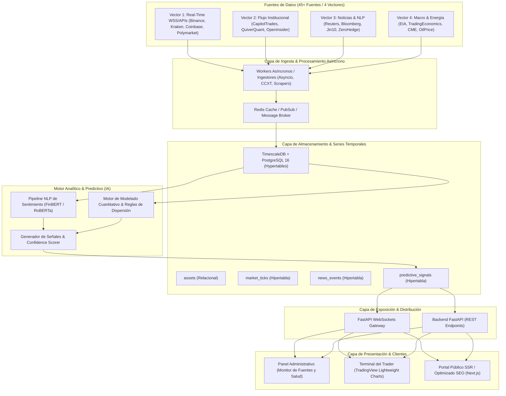

# Contexto General del Proyecto

## 1. Visión y Propósito
El **Motor Predictivo de Tendencias Web (Cripto & Macro)** es una plataforma integral de alta frecuencia diseñada para ingerir, correlacionar y modelar grandes volúmenes de datos procedentes de los mercados financieros tradicionales, criptoactivos, flujos institucionales ("Smart Money"), flujos macroeconómicos y eventos noticiosos analizados mediante Procesamiento de Lenguaje Natural (NLP).

El objetivo central es generar **señales predictivas cuantitativas y contextualizadas en tiempo real**, asistidas por modelos de Inteligencia Artificial, proporcionando niveles precisos de entrada (`entry_price`), gestión de riesgo (`stop_loss`, `take_profit`), métricas de confianza (`confidence_score`) y explicabilidad analítica basada en factores desencadenantes (`trigger_factors`).

---

## 2. Arquitectura General del Sistema

El flujo de extremo a extremo se compone de 5 capas desacopladas y de alta concurrencia:

---

## 3. Vectores de Ingesta de Datos (45+ Fuentes)

1. **Vector 1 (Tiempo Real - WSS/APIs):**
   - Exchanges centralizados y descentralizados: Binance (Global y US), Kraken, Coinbase, CoinMarketCap.
   - Mercados predictivos: Polymarket Gamma API.
   - Frecuencia: Sub-segundo a segundos mediante WebSockets persistentes.

2. **Vector 2 (Flujo Institucional - Smart Money):**
   - Transacciones de congresistas y directores corporativos: CapitolTrades, QuiverQuant, OpenInsider, InsiderArbitrage.
   - Posiciones de fondos y ballenas: Dataroma, WhaleWisdom.
   - Frecuencia: Batch programado / scraping de eventos regulatorios (Form 4, 13F).

3. **Vector 3 (Noticias y Sentimiento NLP):**
   - Breaking news financieras y feeds en vivo: FinancialJuice, Jin10, ZeroHedge, Reuters, Bloomberg, FT, WSJ, Nikkei, Investing, Yahoo Finance, SeekingAlpha.
   - Frecuencia: Event-driven con vectorización y scoring de sentimiento inmediato.

4. **Vector 4 (Macro, Energía y Commodities):**
   - Informes macroeconómicos y reservas: EIA.gov, IEA, CME Group, TradingEconomics, OilPrice, Kitco, LBMA, FreightWaves, Vortexa.
   - Frecuencia: Monitoreo horario y de publicaciones de calendarios económicos (CPI, NFP, tasas de interés, inventarios de crudo).

---

## 4. Esquema de Base de Datos Base (TimescaleDB)

El sistema aprovecha **PostgreSQL 16** con la extensión **TimescaleDB** para almacenar métricas de alta cardinalidad particionadas por tiempo (hypertables):

- `assets`: Catálogo maestro de activos monitoreados (cripto, divisas, índices, commodities).
- `market_ticks` (Hypertable particionada por `time`): Precios, volumen 24h y spread de compra/venta en milisegundos.
- `news_events` (Hypertable particionada por `published_at`): Título, URL, fuente, impacto de sentimiento (-1.000 a +1.000) y activos afectados.
- `predictive_signals` (Hypertable particionada por `generated_at`): Recomendación de acción (BUY, SELL, HOLD, ACCUMULATE), confianza (0-100), targets de precio y factores de justificación en formato JSONB.

---

## 5. Stack Tecnológico

| Capa | Tecnologías |
| :--- | :--- |
| **Base de Datos** | PostgreSQL 16 + TimescaleDB Extension, Redis (caché y broker) |
| **Backend & Ingesta** | Python 3.11+, FastAPI, Uvicorn, CCXT, Asyncio, Pydantic v2, SQLAlchemy / asyncpg |
| **Motor de IA / NLP** | PyTorch / Hugging Face Transformers (FinBERT), scikit-learn, modelos cuantitativos estadísticos |
| **Frontend & Terminal** | Next.js, React, TypeScript, TradingView Lightweight Charts, TailwindCSS |
| **DevOps & Entorno** | Docker, Docker Compose, Linux, Healthchecks continuos |

---

## 6. Fases del Proyecto

- **Fase 1:** Recopilación y Arquitectura (TimescaleDB + PostgreSQL).
- **Fase 2:** Desarrollo del Backend y API (FastAPI + CCXT + Motor de IA).
- **Fase 3:** Desarrollo del Panel Administrativo (Dashboard de Monitoreo).
- **Fase 4:** Desarrollo del Frontend (Terminal del Trader y Gráficos Interactivos).
- **Fase 5:** Optimización SEO, SSR y Core Web Vitals (Lighthouse 90+).
